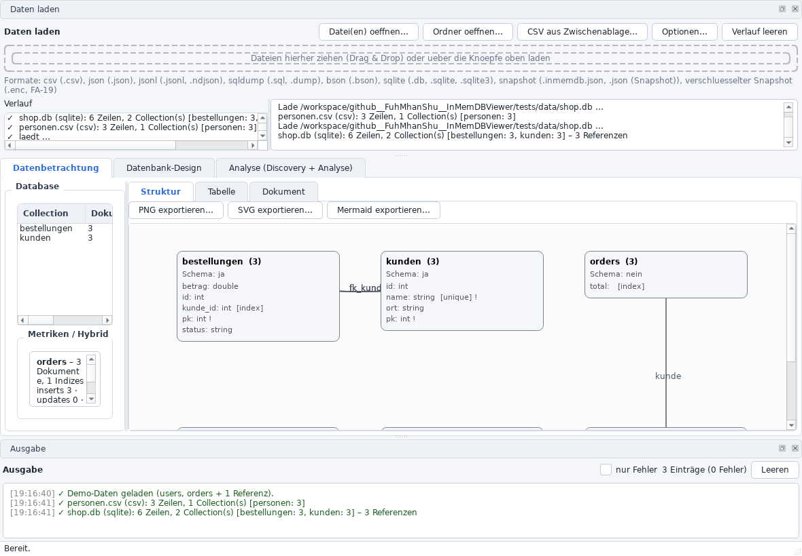
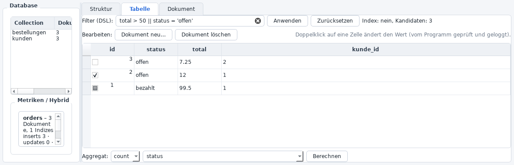
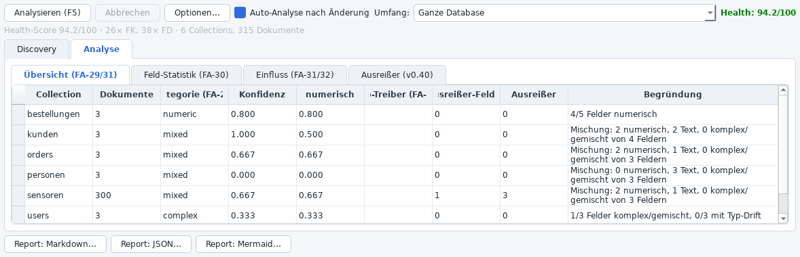
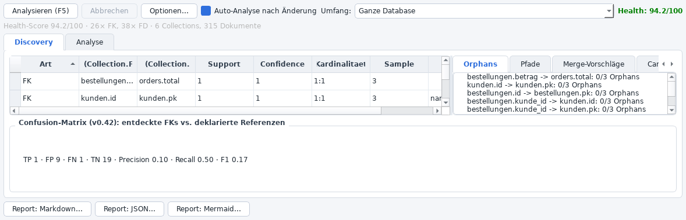
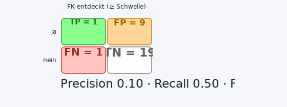
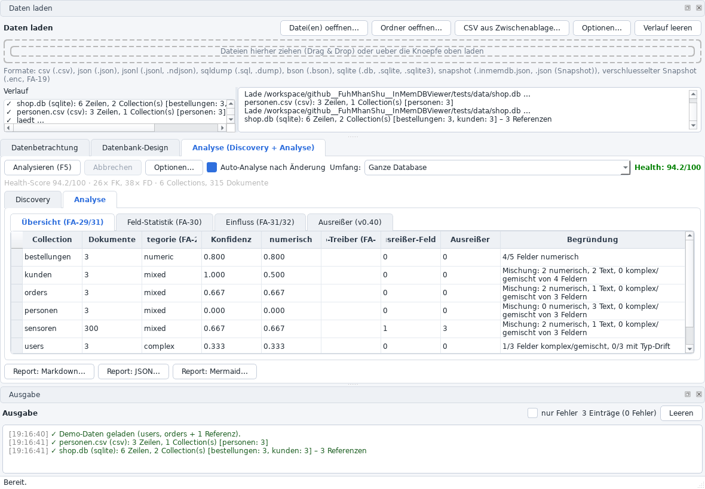
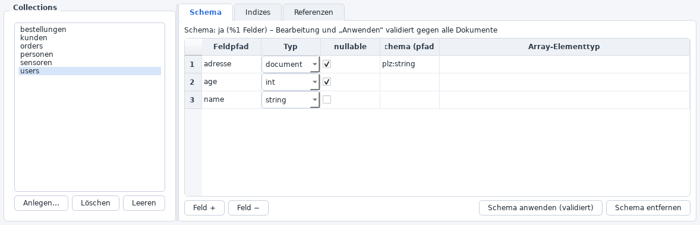
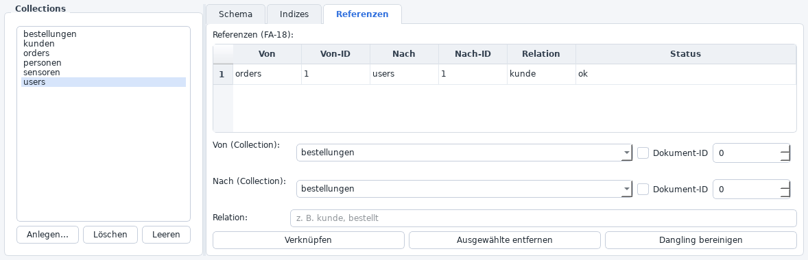
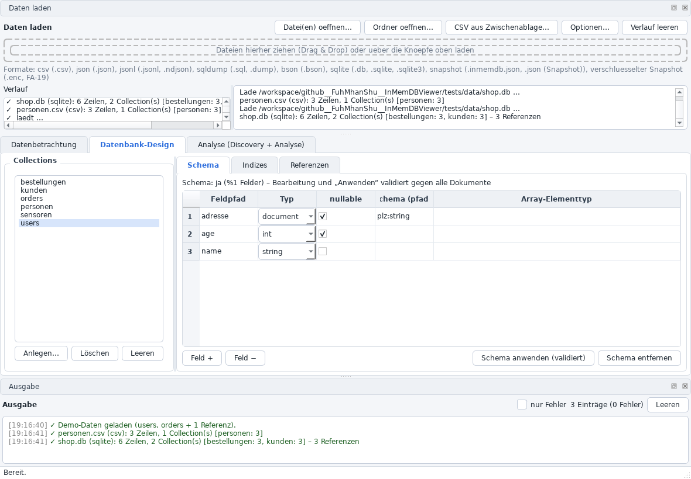

# InMemDBViewer

Visualisierungs- und **Analysetool** für [InMemDB](https://github.com/FuhMhanShu/InMemDB) – C++17/Qt, strikte MVC-Architektur, als Bibliothek + App.

- [Anforderungen](anforderungen.md) (v1.2)

## Konzept (v1.2)

Die GUI besteht aus **gekapselten MVC-Widgets**, die alle an einem gemeinsamen Model (`ViewerCore`: hält `memdb::Database` + `ReferenceIndex`) hängen:

```
MainWindow (Theme: applyViewerTheme – Fusion + helle Palette + Stylesheet, UI-01):
  oben Dock "Daten laden" (einklappbar), Mitte Tabs, unten Dock "Ausgabe" (einklappbar)
  ├─ DataInputWidget        – Dateneingabe: Datei-Dialog, Drag & Drop, CSV aus Zwischenablage,
  │                           Import-Optionen, Verlauf
  ├─ DataViewWidget         – Bereich Datenbetrachtung: Struktur (QGraphicsFramework/DbGraph),
  │                           tabellarische Ansicht (virtualisiert, DSL-Filter, Zellen editierbar),
  │                           Dokument-Detail, Dokument-CRUD
  ├─ DatabaseDesignWidget   – Bereich Datenbank-Design (v1.1): Collections anlegen/löschen/leeren,
  │                           Schema definieren (FA-20), Indizes (FA-10, unique), Referenzen (FA-18)
  ├─ AnalysisWidget         – Bereich Analyse: Discovery (FA-27) + Analyse (FA-29..FA-32, v0.33/v0.40),
  │                           Confusion-Matrix (v0.42), Worker-Thread, Health-Score, Report-Export,
  │                           Auto-Analyse nach jeder Datenmanipulation
  └─ OutputPanel (Dock)     – Ausgabe-Log: jede Operation wird verifiziert, Fehler rot
Toolbar mit Icons (oeffnen/speichern/CSV/analysieren), Menues Datei/Ansicht, Shortcuts (Strg+O, Strg+N, Strg+Shift+V, F5)
```

**UI (v1.2)**: schlankes Tab-/Dock-Layout statt breiter Spalten (UI-02), zentrales Theme (UI-01), kompakte Docks.

**Daten laden** (übergeordnet, InMemDB FA-21 `ImportRegistry`/`Importer`): CSV, JSON/JSONL/NDJSON, SQL-Dump, BSON, SQLite (optional via `INMEMDB_WITH_SQLITE`), InMemDB-Snapshot (`.inmemdb.json`, inkl. verschlüsselt `.enc` mit Passwort, FA-14/FA-19) – sowie **CSV direkt aus der Zwischenablage**. Geladene Daten stehen Datenbetrachtung und Analyse zur Verfügung; Änderungen werden live per Observer (FA-15) an alle Widgets verteilt.

**Design & Bearbeiten (v1.1)**: Neue Datenbank anlegen oder geladene bearbeiten – Collections, Schemas (FA-20), Indizes (FA-10, unique) und Referenzen (FA-18) definieren, Dokumente per Zellen-Edit/JSON-Dialog ändern/löschen, CSV aus der Zwischenablage übernehmen (Zwischenablage-Button im Dateneingabe-Panel). **Jede Operation wird vom Programm verifiziert** (InMemDB-Exceptions werden gefangen, Fehler landen rot im Ausgabe-Dock) und stößt automatisch **Discovery + Analyse** an (`dataMutated()` → Auto-Analyse mit Debounce).

## Screenshots

Erzeugt mit der App (`examples/viewer_app`, headless via `QT_QPA_PLATFORM=offscreen` gerendert), Daten: Demo-Daten + CSV- und SQLite-Import:

| Übersicht nach dem Laden | Datenbetrachtung: Struktur (QGraphicsFramework) |
|---|---|
|  |  |

| Datenbetrachtung: Tabelle mit DSL-Filter | Analyse: Übersicht + Health-Score |
|---|---|
|  |  |

| Analyse: Feld-Statistik (FA-30) mit Histogramm | Analyse: Discovery (FA-27) Relationen |
|---|---|
|  |  |

| Analyse: Confusion-Matrix (InMemDB v0.42) – entdeckte FKs vs. deklarierte Referenzen |
|---|
|  |



### Datenbank-Design & Bearbeiten (v1.1)

| Design: Schema-Editor (Collection „users“, FA-20) | Design: Referenzen (FA-18) |
|---|---|
|  |  |



## Öffentliche API (Namespace `memdb::viewer`, Header unter `include/memdbviewer/`)

| Klasse | Schicht | Zweck |
|---|---|---|
| `ViewerCore` | Model | hält `memdb::Database` + `ReferenceIndex`; Import/Snapshot laden (sync + async), Observer-Bridge → queued Signale (`collectionChanged`, `collectionsChanged`, `databaseLoaded`) |
| `DataInputWidget` | View | Dateneingabe-Panel (Dialog, Drag & Drop, Formate, Optionen, Verlauf, Status) |
| `DataViewWidget` | View | Datenbetrachtung: Datenbank-Übersicht, Struktur-Szene (QGraphicsFramework), Dokument-Tabelle (editierbar), Dokument-Detail, Dokument-CRUD |
| `DatabaseDesignWidget` | View | Datenbank-Design (v1.1): Collections, Schema-Editor, Indizes, Referenzen – verifiziert über `ViewerCore` |
| `AnalysisWidget` | View | Analyse: Discovery + Analyse im Worker-Thread, Confusion-Matrix (v0.42), Health-Ampel, Report-Export (Markdown/JSON/Mermaid), Auto-Analyse nach `dataMutated()` |
| `OutputPanel` | View | Ausgabe-Dock: verifiziertes Log (Fehler rot, Filter „nur Fehler“) |

Interne MVC-Teile (Model/Controller je Widget) liegen gekapselt in `src/` (`ImportModel`, `DataInputController`, …).

## Voraussetzungen

C++17-Compiler, Qt 5.15+ oder Qt 6 (Widgets, Svg, Test), InMemDB (Default: Schwestern-Checkout `../InMemDB`, sonst Pfad setzen). Optionaler SQLite-Import: `libsqlite3-dev` + Build-Option.

## Build & Tests (CMake)

```sh
cmake -S . -B build -DINMEMDB_DIR=../InMemDB                 # + -DINMEMDBVIEWER_WITH_SQLITE=ON fuer SQLite-Import
cmake --build build -j
QT_QPA_PLATFORM=offscreen ctest --test-dir build --output-on-failure
QT_QPA_PLATFORM=offscreen ./build/viewer_app                  # App-Smoke-Test (headless, beendet sich selbst)
```

## Build & Tests (qmake)

```sh
qmake InMemDBViewer.pro && make -j                 # -> libInMemDBViewer.a (ggf. "CONFIG+=viewer_sqlite")
mkdir build-tests && cd build-tests && qmake ../tests/tests.pro && make -j
QT_QPA_PLATFORM=offscreen ./viewer_tests           # QtTest headless (NFA-05)
mkdir build-app && cd build-app && qmake ../examples/viewer_app/viewer_app.pro && make -j
QT_QPA_PLATFORM=offscreen ./viewer_app              # App-Smoke-Test
```

## Einbindung in ein eigenes qmake-Projekt

```qmake
QT += widgets svg
INMEMDBVIEWER_DIR = /pfad/zu/InMemDBViewer
INMEMDB_DIR = /pfad/zu/InMemDB
include($$INMEMDBVIEWER_DIR/InMemDBViewer.pri)  # Variante A: libInMemDBViewer.a linken
# oder: DEFINES += INMEMDBVIEWER_BUILD_SOURCES   # Variante B: Quellen mitkompilieren
# optional: CONFIG += viewer_sqlite               # SQLite-Import (libsqlite3)
```

## Mini-Beispiel

```cpp
#include <memdbviewer/viewer.hpp>

memdb::viewer::ViewerCore core;                 // Model: haelt die Database
core.loadDemoData();                            // oder: core.importFile("daten.csv");

memdb::viewer::DataInputWidget input;           // Dateneingabe (Dialog + Drag & Drop)
memdb::viewer::DataViewWidget view;             // Datenbetrachtung (Struktur/Tabelle/Dokument)
memdb::viewer::AnalysisWidget analysis;         // Analyse (Discovery + Analyse, Worker-Thread)
input.setCore(&core);
view.setCore(&core);
analysis.setCore(&core);
```

## CI

GitHub Actions (`.github/workflows/ci.yml`): CMake-Build + QtTest (headless) + App-Smoke-Test für Qt 6 (mit SQLite-Import) und Qt 5.15 sowie ein qmake-Build inkl. SQLite. InMemDB wird als öffentlicher Schwestern-Checkout mitgebaut (kein Secret nötig).

## Lizenz

MIT (wie InMemDB).
